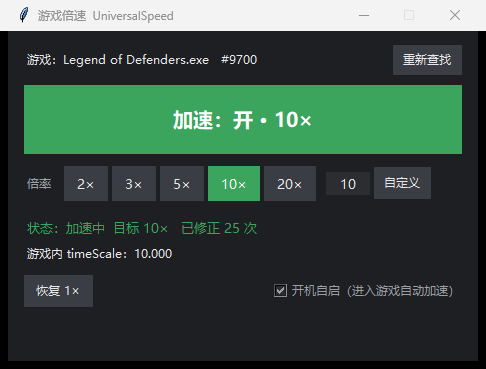

# UniversalSpeed 1.1 — 通用 Unity IL2CPP 游戏倍速工具（带界面）

Windows x64 便携工具，给 **Unity IL2CPP** 引擎的游戏加速/减速（时间缩放）。
**双击 `UniversalSpeed.exe` 就是界面，点开关就行，不用敲命令。**


## 用界面（推荐）

双击 `UniversalSpeed.exe`：

| 界面元素 | 作用 |
|---|---|
| 顶部「游戏：xxx #pid」 | 自动找到正在跑的 Unity 游戏；没开就先显示「没找到」，开游戏后自己接上 |
| 大按钮「加速：关 / 开 · 10×」 | 点一下开关。开 = 开始守护并把倍率钉到选定值；关 = 立刻恢复 1× |
| 倍率 `2× 3× 5× 10× 20×` | 点一下就切，加速中改倍率立即生效 |
| 输入框 + `自定义` | 手填任意倍率（0.1 ~ 100），回车或点按钮生效 |
| 状态行 | `加速中 目标 10× 已修正 N 次`，N 就是游戏重置过多少次 |
| `游戏内 timeScale` | 直接读游戏里的真实值，用来确认是否生效 |
| `恢复 1×` | 一键回正常速度 |
| `开机自启` | 勾上后每次登录自动开界面并进入加速状态（10×）；取消勾选删掉自启 |

换游戏：直接把游戏打开，点「重新查找」，或者关掉界面重开。

## 用命令行（可选，给批处理/远程用）

```
UniversalSpeed.exe list                    列出正在运行的 Unity 游戏（pid / 进程名 / 窗口标题）
UniversalSpeed.exe diag                    诊断：能看到多少进程、找到几个 IL2CPP 游戏
UniversalSpeed.exe status                  看当前倍速
UniversalSpeed.exe set 10                  一次性设成 10 倍
UniversalSpeed.exe pin 10                  常驻守护，被改回就自动改回（Ctrl+C 停）
UniversalSpeed.exe pin 10 --pid 1234       指定进程
UniversalSpeed.exe set 5 --game "legend"   按进程名/窗口标题模糊匹配
```

其他参数：`--all`（`list` 连无窗口的 Unity 进程一起列）、`--interval 0.25`（`pin` 轮询间隔）。
从 cmd 里带参数启动时，输出会接回当前控制台；双击启动（无参数）永远是界面。

## 怎么确认生效

1. 界面「游戏内 timeScale」跟着你设的值变；
2. 游戏内计时器 / 倒计时 / 动画按倍数走得快（10× 时 1 秒实际时间 ≈ 游戏内 10 秒）；
3. 状态行「已修正 N 次」在涨，说明游戏重置过速度、工具又改回来了。

## 常见问题

**OpenProcess 失败（err=5）/ 界面里一直「没找到游戏」**
以管理员身份运行本工具。游戏以管理员启动时工具也必须管理员。

**`diag` 里「进程枚举」只有二三十个，明显不对**
当前进程被沙箱 / 限制令牌隔离了（放在某些工具的工作目录、企业安全软件、沙箱环境里都会）。把整个文件夹挪到普通目录（例如 `D:\Tools\UniversalSpeed`）再跑。

**「GameAssembly.dll 里缺少导出」/「目标不是 IL2CPP」**
这是 Mono 版 Unity（游戏目录没有 `GameAssembly.dll`，只有 `Managed\Assembly-CSharp.dll`）。本工具只支持 IL2CPP。

**反作弊**
带内核级反作弊的联机游戏（EAC / BE / Vanguard 等）会拦截进程读写和远程线程，本工具不做绕过。

**杀毒误报**
PyInstaller 打包的程序常被误判。源码 `UniversalSpeed.py` / `UniversalSpeedGUI.py` 就在包里，可自行 `python UniversalSpeedGUI.py` 运行（Python 3.9+，纯标准库 + tkinter）。

## 文件

| 文件 | 说明 |
|---|---|
| `UniversalSpeed.exe` | 主程序（界面 + 命令行，Python 运行时已打包） |
| `_internal\` | 运行库，别删 |
| `UniversalSpeed.py` | 内核源码（进程/内存/IL2CPP 调用），纯标准库 |
| `UniversalSpeedGUI.py` | 界面源码（tkinter） |
| `停止倍速.vbs` | 恢复 1× 并结束所有 UniversalSpeed（无黑框） |
| `README.md` | 本文件 |

> 为什么不做成单文件 exe：PyInstaller 的 onefile 会先解包到 `%TEMP%`，
> 在中文路径 / 受限环境下解包会失败（`Could not create temporary directory`）。
> 目录版启动更快、更稳，整个文件夹拷贝即用。

## 原理（一句话版）

1. 找到加载了 `GameAssembly.dll` 的进程，读它磁盘上的 `GameAssembly.dll` 导出表，拿到 `il2cpp_*` 的 RVA；
2. `运行期基址 + RVA` 得到地址，`VirtualAllocEx` 写一小段 shellcode 当 thunk，`CreateRemoteThread` 调用；
3. 走 `il2cpp_domain_get → il2cpp_domain_assembly_open("UnityEngine.CoreModule.dll") → il2cpp_assembly_get_image → il2cpp_class_from_name("UnityEngine","Time") → il2cpp_class_get_method_from_name`，拿到 `set/get_timeScale` 的 `MethodInfo*` 与函数指针；
4. 之后 `rcx = MethodInfo*`、`xmm0 = 倍率`，直接 call 函数指针，读 `xmm0` 取返回值。

因为用的是引擎自己的 API，不依赖任何游戏的偏移或版本号。

## 从源码构建

```
git clone https://github.com/kkyu123/UniversalSpeed.git
cd UniversalSpeed
pip install pyinstaller
python -m PyInstaller --noconfirm --onedir --windowed --name UniversalSpeed UniversalSpeedGUI.py
```

或者直接 `powershell -ExecutionPolicy Bypass -File build.ps1`。
产物在 `dist\UniversalSpeed\`，整个目录拷出去就能用。
不想打包也行：`python UniversalSpeedGUI.py` 直接跑界面（需要 Python 3.9+，纯标准库 + tkinter）。

预编译包见 [Releases](https://github.com/kkyu123/UniversalSpeed/releases)。

## 许可证

MIT
